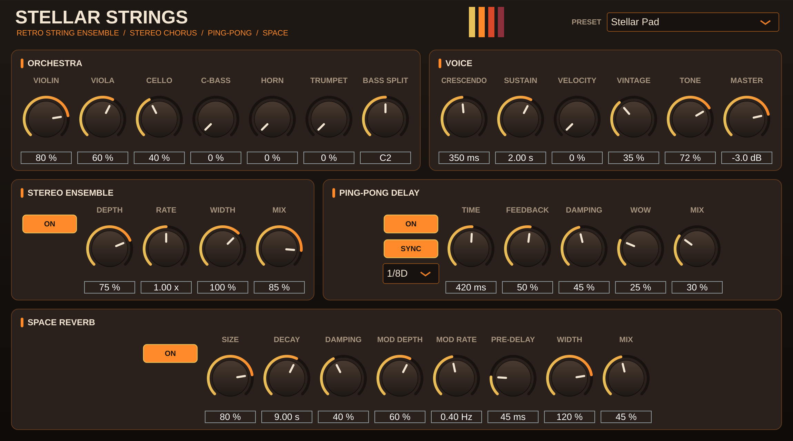

# Stellar Strings

Ein Audio-Unit-Instrument (AUv2, außerdem VST3/Standalone) für weite, spacige
Retro-String-Ensemble-Klänge im Stil der Divider-String-Maschinen der 70er.



## Signalfluss

```
MIDI → String-Engine (vollpolyphon, 32 Stimmen)
     → Register-Filterbank (Violin · Viola · Cello · Contrabass · Horn · Trumpet)
     → Stereo-Ensemble (3-Phasen-BBD-Chorus, L/R gespiegelt)
     → Stereo-Ping-Pong-Delay (Tempo-Sync, Bandecho-Dämpfung, Wow)
     → Space Reverb (moduliertes 8-Kanal-FDN, Pre-Delay, Breite)
     → Master
```

**String-Engine:** Bandbegrenzte Sägezähne in 16', 8' und 4' und ein 8'-Rechteck pro
Stimme. Die Oszillatoren laufen mit Zufallsphase frei wie bei einem Top-Octave-Divider.
Die Register entstehen wie beim Original erst nach der Summierung durch feste Formantfilter.
Contrabass klingt nur unterhalb von *Bass Split*. *Crescendo*/*Sustain* entsprechen
Attack/Release, *Vintage* fügt Stimmenstreuung und langsame Tonhöhendrift hinzu.
Unterstützt Pitch-Bend (±2 Halbtöne) und Sustain-Pedal.

**Stereo Ensemble:** Sechs Abgriffe aus einer Delay-Linie, moduliert durch einen
langsamen (≈0,63 Hz) und einen schnellen (≈5,9 Hz) LFO. Links liegen die Phasen
0°/120°/240°, rechts 60°/180°/300°, also exakt gespiegelt. *Rate* skaliert beide LFOs.

**Ping-Pong Delay:** Das Signal startet links und springt dann hin und her. Im Feedback
sitzen Hochpass und Tiefpass. Sync-Werte von 1/32 bis 1/1 inkl. triolisch/punktiert,
alternativ 20–2000 ms frei.

**Space Reverb:** Hadamard-FDN mit 8 modulierten Delay-Linien, Eingangs-Diffusion,
Decay 0,5–30 s, Size, Damping, Mod Depth/Rate, Pre-Delay bis 250 ms, Width.

**Presets:** Stellar Pad · Classic Ensemble · Cosmic Cello Drift · Orbit Brass & Strings ·
Deep Space · Dry Divider

## Bauen auf dem Mac

Voraussetzungen: Xcode (oder die Command Line Tools) und CMake ≥ 3.22
(`brew install cmake`). JUCE 8 wird automatisch heruntergeladen.

```bash
cmake -B build -G Xcode
cmake --build build --config Release --target StellarStrings_AU
```

Die Komponente wird automatisch nach `~/Library/Audio/Plug-Ins/Components/` kopiert.
Prüfen mit:

```bash
auval -v aumu Stst Stla
```

Danach in Logic Pro als *Instrument → AU-Instrumente → Stellar Audio → Stellar Strings*
laden. Taucht das Plugin nicht sofort auf, hilft ein Neustart von Logic oder
`killall -9 AudioComponentRegistrar`.

Ohne eigenen Build: Der Workflow `.github/workflows/build-macos.yml` baut auf GitHub
AU + VST3 als Universal Binary, validiert mit `auval` und stellt ZIPs als Artefakt
bereit. Selbst gebaute, nicht signierte Plugins müssen eventuell per
`xattr -dr com.apple.quarantine "Stellar Strings.component"` freigegeben werden.

## Offline-Test

```bash
cmake -B build -DSTELLAR_BUILD_RENDER_TEST=ON
cmake --build build --target StellarRenderTest
./build/StellarRenderTest_artefacts/Release/StellarRenderTest <ausgabeordner>
```

Rendert jedes Preset als WAV und prüft auf NaN/Inf, Pegel und State-Save/Load.
